<picture>
  <source media="(prefers-color-scheme: dark)" srcset="assets/header-dark.svg" />
  <source media="(prefers-color-scheme: light)" srcset="assets/header-light.svg" />
  
</picture>

<div align="center">

[](https://gabrielsallessi.github.io/sojapredict-atlas/)

[](https://www.linkedin.com/in/gabriel-s%C3%A1-da-silveira-1298ab201/)
[](mailto:gabrielsadasilveira@gmail.com)
[](https://wa.me/5562993844474)

<sub>🇺🇸 English below · 🇧🇷 [Versão em português](#-em-português)</sub>

</div>

## 👋 About me

```ts
const gabriel = {
  role:      ["Front-end Developer", "E-commerce Developer", "ML for Agriculture"],
  location:  "Anápolis, Goiás, Brazil 🇧🇷  ·  open to remote",
  building:  ["Shopify themes", "WooCommerce + Stripe checkouts", "React data apps"],
  education: {
    msc: "Agricultural Engineering, UEG (soybean yield prediction with ML)",
    mba: "Technology for Business: AI, Data Science & Big Data, PUCRS",
    cs50: "Harvard CS50",
  },
  languages: ["Portuguese (native)", "English (full professional)", "Spanish (basic)"],
};
```

<details>
<summary><b>🛒 What I do for clients</b> (click to expand)</summary>
<br/>

- Product pages with **bundles, subscriptions and custom pricing**, AJAX carts and custom checkouts
- **Shopify OS 2.0 themes** built from scratch in Liquid, CSS and vanilla JavaScript
- **WordPress / WooCommerce** customization with PHP hooks and snippets
- **Stripe** payments, including embedded checkout
- **Meta Pixel and Conversions API** tracking, **domain and DNS** setup (Vercel, Hostinger, WordPress.com)
- Working with clients in the **US and Brazil**, in English and Portuguese

</details>

<details>
<summary><b>🌱 My research</b> (click to expand)</summary>
<br/>

My MSc dissertation, *"Soybean yield prediction in Goiás with machine learning: a computational decision support system"*, compares **Linear Regression, Random Forest, XGBoost and MLP** on 660 municipality-season observations (55 municipalities, 2014–2025) with climate and water-balance data. Random Forest came out on top (cross-validated R² 0.55). I turned it into a web app with a model that **runs entirely in the browser**: [SojaPredict Atlas](https://gabrielsallessi.github.io/sojapredict-atlas/?lang=en).

</details>

## 🚀 Featured project

<table>
<tr>
<td width="55%">
<a href="https://gabrielsallessi.github.io/sojapredict-atlas/?lang=en"></a>
</td>
<td>

### [SojaPredict Atlas](https://github.com/gabrielSallesSi/sojapredict-atlas)

Interactive atlas of soybean yield in Goiás, Brazil. Animated choropleth map, model comparison, and a **Random Forest that runs in your browser** to simulate climate scenarios.

`React` `TypeScript` `D3` `Tailwind` `Framer Motion` `scikit-learn`

[](https://gabrielsallessi.github.io/sojapredict-atlas/?lang=en)

</td>
</tr>
</table>

## 🧰 More projects

| | Project | What it is | Stack |
|:-:|---|---|---|
| 🏔️ | [**Tamarack**](https://github.com/gabrielSallesSi/tamarack-shopify-theme) | Shopify OS 2.0 theme from scratch: live color switching, 3D product viewer with AR, bundle discounts, AJAX cart drawer · [live store](https://tamarack-gtqamv8f.myshopify.com) (password `tamarack`) | Liquid · CSS · JS |
| 🧴 | [**Dewlune**](https://github.com/gabrielSallesSi/dewlune) | Skincare Shopify theme with motion effects and high-resolution imagery | Liquid · CSS · JS |
| 🌾 | [**SojaPredict GO**](https://github.com/gabrielSallesSi/SojaSa) | MSc research platform: data pipeline, ML training and statistical analysis with a web dashboard | Python · Flask · scikit-learn |
| 📡 | [**Grain monitor**](https://github.com/gabrielSallesSi/A-circuit-that-monitors-soybean-temperature-humidity-and-carbon) | Circuit that monitors temperature, humidity and CO₂ in stored soybeans in real time | C++ · Arduino |
| ⛅ | [**Weather**](https://github.com/gabrielSallesSi/Weather) | Weather app on a public API: temperature, humidity and wind by city | HTML · CSS · JS |

## 🗺️ Explore my research area

The map below is **interactive**: zoom in and click a dot to see each municipality's average soybean yield. 🟡 top third · 🟢 middle · 🌲 bottom third.

```geojson
{"type":"FeatureCollection","features":[{"type":"Feature","geometry":{"type":"Point","coordinates":[-47.52,-14.13]},"properties":{"Municipality":"Alto Paraíso de Goiás","Region":"North","Avg. yield 2014–2025":"2,944 kg/ha","Best season":"3,524 kg/ha","Avg. rainfall":"1,359 mm/yr","marker-color":"#2d6a4f","marker-size":"small"}},{"type":"Feature","geometry":{"type":"Point","coordinates":[-48.95,-16.33]},"properties":{"Municipality":"Anápolis","Region":"Center","Avg. yield 2014–2025":"3,116 kg/ha","Best season":"3,944 kg/ha","Avg. rainfall":"1,472 mm/yr","marker-color":"#2d6a4f","marker-size":"small"}},{"type":"Feature","geometry":{"type":"Point","coordinates":[-51.92,-18.96]},"properties":{"Municipality":"Aporé","Region":"Southwest","Avg. yield 2014–2025":"3,492 kg/ha","Best season":"4,220 kg/ha","Avg. rainfall":"1,636 mm/yr","marker-color":"#e9c46a","marker-size":"small"}},{"type":"Feature","geometry":{"type":"Point","coordinates":[-48.96,-16.97]},"properties":{"Municipality":"Bela Vista de Goiás","Region":"Center","Avg. yield 2014–2025":"3,225 kg/ha","Best season":"3,963 kg/ha","Avg. rainfall":"1,426 mm/yr","marker-color":"#7bd389","marker-size":"small"}},{"type":"Feature","geometry":{"type":"Point","coordinates":[-49.74,-18.22]},"properties":{"Municipality":"Bom Jesus de Goiás","Region":"South","Avg. yield 2014–2025":"3,263 kg/ha","Best season":"4,289 kg/ha","Avg. rainfall":"1,401 mm/yr","marker-color":"#7bd389","marker-size":"small"}},{"type":"Feature","geometry":{"type":"Point","coordinates":[-50.94,-18.76]},"properties":{"Municipality":"Cachoeira Alta","Region":"South","Avg. yield 2014–2025":"3,218 kg/ha","Best season":"4,080 kg/ha","Avg. rainfall":"1,377 mm/yr","marker-color":"#7bd389","marker-size":"small"}},{"type":"Feature","geometry":{"type":"Point","coordinates":[-51.81,-16.96]},"properties":{"Municipality":"Caiapônia","Region":"Southwest","Avg. yield 2014–2025":"3,357 kg/ha","Best season":"4,176 kg/ha","Avg. rainfall":"1,631 mm/yr","marker-color":"#7bd389","marker-size":"small"}},{"type":"Feature","geometry":{"type":"Point","coordinates":[-46.77,-13.04]},"properties":{"Municipality":"Campos Belos","Region":"North","Avg. yield 2014–2025":"2,792 kg/ha","Best season":"3,346 kg/ha","Avg. rainfall":"1,111 mm/yr","marker-color":"#2d6a4f","marker-size":"small"}},{"type":"Feature","geometry":{"type":"Point","coordinates":[-47.95,-18.17]},"properties":{"Municipality":"Catalão","Region":"East","Avg. yield 2014–2025":"3,498 kg/ha","Best season":"4,372 kg/ha","Avg. rainfall":"1,420 mm/yr","marker-color":"#e9c46a","marker-size":"small"}},{"type":"Feature","geometry":{"type":"Point","coordinates":[-51.13,-19.1]},"properties":{"Municipality":"Caçu","Region":"South","Avg. yield 2014–2025":"3,213 kg/ha","Best season":"3,911 kg/ha","Avg. rainfall":"1,358 mm/yr","marker-color":"#7bd389","marker-size":"small"}},{"type":"Feature","geometry":{"type":"Point","coordinates":[-49.6,-15.31]},"properties":{"Municipality":"Ceres","Region":"Center","Avg. yield 2014–2025":"3,058 kg/ha","Best season":"3,744 kg/ha","Avg. rainfall":"1,450 mm/yr","marker-color":"#2d6a4f","marker-size":"small"}},{"type":"Feature","geometry":{"type":"Point","coordinates":[-52.52,-18.41]},"properties":{"Municipality":"Chapadão do Céu","Region":"Southwest","Avg. yield 2014–2025":"3,761 kg/ha","Best season":"4,840 kg/ha","Avg. rainfall":"1,629 mm/yr","marker-color":"#e9c46a","marker-size":"small"}},{"type":"Feature","geometry":{"type":"Point","coordinates":[-47.61,-16.77]},"properties":{"Municipality":"Cristalina","Region":"East","Avg. yield 2014–2025":"3,768 kg/ha","Best season":"4,391 kg/ha","Avg. rainfall":"1,439 mm/yr","marker-color":"#e9c46a","marker-size":"small"}},{"type":"Feature","geometry":{"type":"Point","coordinates":[-52.33,-17.29]},"properties":{"Municipality":"Doverlândia","Region":"Southwest","Avg. yield 2014–2025":"3,430 kg/ha","Best season":"4,154 kg/ha","Avg. rainfall":"1,637 mm/yr","marker-color":"#e9c46a","marker-size":"small"}},{"type":"Feature","geometry":{"type":"Point","coordinates":[-49.93,-17.34]},"properties":{"Municipality":"Edéia","Region":"Center","Avg. yield 2014–2025":"3,377 kg/ha","Best season":"4,095 kg/ha","Avg. rainfall":"1,521 mm/yr","marker-color":"#7bd389","marker-size":"small"}},{"type":"Feature","geometry":{"type":"Point","coordinates":[-47.05,-14.43]},"properties":{"Municipality":"Flores de Goiás","Region":"North","Avg. yield 2014–2025":"2,944 kg/ha","Best season":"3,714 kg/ha","Avg. rainfall":"1,096 mm/yr","marker-color":"#2d6a4f","marker-size":"small"}},{"type":"Feature","geometry":{"type":"Point","coordinates":[-47.34,-15.54]},"properties":{"Municipality":"Formosa","Region":"North","Avg. yield 2014–2025":"3,096 kg/ha","Best season":"3,894 kg/ha","Avg. rainfall":"1,332 mm/yr","marker-color":"#2d6a4f","marker-size":"small"}},{"type":"Feature","geometry":{"type":"Point","coordinates":[-49.12,-15.32]},"properties":{"Municipality":"Goianésia","Region":"Center","Avg. yield 2014–2025":"3,148 kg/ha","Best season":"3,908 kg/ha","Avg. rainfall":"1,423 mm/yr","marker-color":"#2d6a4f","marker-size":"small"}},{"type":"Feature","geometry":{"type":"Point","coordinates":[-49.36,-18.02]},"properties":{"Municipality":"Goiatuba","Region":"South","Avg. yield 2014–2025":"3,272 kg/ha","Best season":"4,321 kg/ha","Avg. rainfall":"1,372 mm/yr","marker-color":"#7bd389","marker-size":"small"}},{"type":"Feature","geometry":{"type":"Point","coordinates":[-50.14,-18.49]},"properties":{"Municipality":"Gouvelândia","Region":"South","Avg. yield 2014–2025":"3,233 kg/ha","Best season":"3,826 kg/ha","Avg. rainfall":"1,388 mm/yr","marker-color":"#7bd389","marker-size":"small"}},{"type":"Feature","geometry":{"type":"Point","coordinates":[-46.5,-14.6]},"properties":{"Municipality":"Guaraí","Region":"North","Avg. yield 2014–2025":"2,854 kg/ha","Best season":"3,474 kg/ha","Avg. rainfall":"1,110 mm/yr","marker-color":"#2d6a4f","marker-size":"small"}},{"type":"Feature","geometry":{"type":"Point","coordinates":[-49.5,-16.36]},"properties":{"Municipality":"Inhumas","Region":"Center","Avg. yield 2014–2025":"3,150 kg/ha","Best season":"3,806 kg/ha","Avg. rainfall":"1,447 mm/yr","marker-color":"#2d6a4f","marker-size":"small"}},{"type":"Feature","geometry":{"type":"Point","coordinates":[-48.16,-17.72]},"properties":{"Municipality":"Ipameri","Region":"East","Avg. yield 2014–2025":"3,429 kg/ha","Best season":"4,122 kg/ha","Avg. rainfall":"1,396 mm/yr","marker-color":"#e9c46a","marker-size":"small"}},{"type":"Feature","geometry":{"type":"Point","coordinates":[-49.81,-16.02]},"properties":{"Municipality":"Itaberaí","Region":"Center","Avg. yield 2014–2025":"3,175 kg/ha","Best season":"3,864 kg/ha","Avg. rainfall":"1,445 mm/yr","marker-color":"#2d6a4f","marker-size":"small"}},{"type":"Feature","geometry":{"type":"Point","coordinates":[-49.22,-18.42]},"properties":{"Municipality":"Itumbiara","Region":"South","Avg. yield 2014–2025":"3,350 kg/ha","Best season":"4,227 kg/ha","Avg. rainfall":"1,351 mm/yr","marker-color":"#7bd389","marker-size":"small"}},{"type":"Feature","geometry":{"type":"Point","coordinates":[-51.72,-17.88]},"properties":{"Municipality":"Jataí","Region":"Southwest","Avg. yield 2014–2025":"3,738 kg/ha","Best season":"4,784 kg/ha","Avg. rainfall":"1,637 mm/yr","marker-color":"#e9c46a","marker-size":"small"}},{"type":"Feature","geometry":{"type":"Point","coordinates":[-47.95,-16.25]},"properties":{"Municipality":"Luziânia","Region":"East","Avg. yield 2014–2025":"3,380 kg/ha","Best season":"4,202 kg/ha","Avg. rainfall":"1,415 mm/yr","marker-color":"#e9c46a","marker-size":"small"}},{"type":"Feature","geometry":{"type":"Point","coordinates":[-50.34,-17.97]},"properties":{"Municipality":"Maurilândia","Region":"Southwest","Avg. yield 2014–2025":"3,432 kg/ha","Best season":"4,233 kg/ha","Avg. rainfall":"1,500 mm/yr","marker-color":"#e9c46a","marker-size":"small"}},{"type":"Feature","geometry":{"type":"Point","coordinates":[-52.55,-17.57]},"properties":{"Municipality":"Mineiros","Region":"Southwest","Avg. yield 2014–2025":"3,666 kg/ha","Best season":"4,571 kg/ha","Avg. rainfall":"1,646 mm/yr","marker-color":"#e9c46a","marker-size":"small"}},{"type":"Feature","geometry":{"type":"Point","coordinates":[-46.88,-13.25]},"properties":{"Municipality":"Monte Alegre de Goiás","Region":"North","Avg. yield 2014–2025":"2,914 kg/ha","Best season":"3,704 kg/ha","Avg. rainfall":"1,108 mm/yr","marker-color":"#2d6a4f","marker-size":"small"}},{"type":"Feature","geometry":{"type":"Point","coordinates":[-51.17,-17.44]},"properties":{"Municipality":"Montividiu","Region":"Southwest","Avg. yield 2014–2025":"3,581 kg/ha","Best season":"4,425 kg/ha","Avg. rainfall":"1,516 mm/yr","marker-color":"#e9c46a","marker-size":"small"}},{"type":"Feature","geometry":{"type":"Point","coordinates":[-48.46,-14.47]},"properties":{"Municipality":"Niquelândia","Region":"North","Avg. yield 2014–2025":"2,894 kg/ha","Best season":"3,504 kg/ha","Avg. rainfall":"1,438 mm/yr","marker-color":"#2d6a4f","marker-size":"small"}},{"type":"Feature","geometry":{"type":"Point","coordinates":[-48.3,-17.03]},"properties":{"Municipality":"Orizona","Region":"East","Avg. yield 2014–2025":"3,341 kg/ha","Best season":"4,179 kg/ha","Avg. rainfall":"1,413 mm/yr","marker-color":"#7bd389","marker-size":"small"}},{"type":"Feature","geometry":{"type":"Point","coordinates":[-51.89,-16.72]},"properties":{"Municipality":"Palestina de Goiás","Region":"Southwest","Avg. yield 2014–2025":"3,486 kg/ha","Best season":"4,364 kg/ha","Avg. rainfall":"1,643 mm/yr","marker-color":"#e9c46a","marker-size":"small"}},{"type":"Feature","geometry":{"type":"Point","coordinates":[-49.93,-16.8]},"properties":{"Municipality":"Palmeiras de Goiás","Region":"Center","Avg. yield 2014–2025":"3,370 kg/ha","Best season":"4,199 kg/ha","Avg. rainfall":"1,505 mm/yr","marker-color":"#7bd389","marker-size":"small"}},{"type":"Feature","geometry":{"type":"Point","coordinates":[-50.63,-18.92]},"properties":{"Municipality":"Paranaiguara","Region":"South","Avg. yield 2014–2025":"3,103 kg/ha","Best season":"3,694 kg/ha","Avg. rainfall":"1,395 mm/yr","marker-color":"#2d6a4f","marker-size":"small"}},{"type":"Feature","geometry":{"type":"Point","coordinates":[-50.44,-16.96]},"properties":{"Municipality":"Paraúna","Region":"Center","Avg. yield 2014–2025":"3,542 kg/ha","Best season":"4,517 kg/ha","Avg. rainfall":"1,530 mm/yr","marker-color":"#e9c46a","marker-size":"small"}},{"type":"Feature","geometry":{"type":"Point","coordinates":[-51.73,-17.78]},"properties":{"Municipality":"Perolândia","Region":"Southwest","Avg. yield 2014–2025":"3,592 kg/ha","Best season":"4,390 kg/ha","Avg. rainfall":"1,613 mm/yr","marker-color":"#e9c46a","marker-size":"small"}},{"type":"Feature","geometry":{"type":"Point","coordinates":[-48.28,-17.3]},"properties":{"Municipality":"Pires do Rio","Region":"East","Avg. yield 2014–2025":"3,292 kg/ha","Best season":"3,940 kg/ha","Avg. rainfall":"1,409 mm/yr","marker-color":"#7bd389","marker-size":"small"}},{"type":"Feature","geometry":{"type":"Point","coordinates":[-50.11,-17.81]},"properties":{"Municipality":"Porteirão","Region":"South","Avg. yield 2014–2025":"3,214 kg/ha","Best season":"3,815 kg/ha","Avg. rainfall":"1,367 mm/yr","marker-color":"#7bd389","marker-size":"small"}},{"type":"Feature","geometry":{"type":"Point","coordinates":[-52.69,-17.38]},"properties":{"Municipality":"Portelândia","Region":"Southwest","Avg. yield 2014–2025":"3,450 kg/ha","Best season":"4,169 kg/ha","Avg. rainfall":"1,696 mm/yr","marker-color":"#e9c46a","marker-size":"small"}},{"type":"Feature","geometry":{"type":"Point","coordinates":[-46.37,-14.09]},"properties":{"Municipality":"Posse","Region":"North","Avg. yield 2014–2025":"2,916 kg/ha","Best season":"3,639 kg/ha","Avg. rainfall":"1,095 mm/yr","marker-color":"#2d6a4f","marker-size":"small"}},{"type":"Feature","geometry":{"type":"Point","coordinates":[-50.44,-18.44]},"properties":{"Municipality":"Quirinópolis","Region":"South","Avg. yield 2014–2025":"3,189 kg/ha","Best season":"3,760 kg/ha","Avg. rainfall":"1,389 mm/yr","marker-color":"#7bd389","marker-size":"small"}},{"type":"Feature","geometry":{"type":"Point","coordinates":[-50.93,-17.8]},"properties":{"Municipality":"Rio Verde","Region":"Southwest","Avg. yield 2014–2025":"3,864 kg/ha","Best season":"4,742 kg/ha","Avg. rainfall":"1,517 mm/yr","marker-color":"#e9c46a","marker-size":"small"}},{"type":"Feature","geometry":{"type":"Point","coordinates":[-49.8,-15.17]},"properties":{"Municipality":"Rubiataba","Region":"Center","Avg. yield 2014–2025":"3,027 kg/ha","Best season":"3,527 kg/ha","Avg. rainfall":"1,425 mm/yr","marker-color":"#2d6a4f","marker-size":"small"}},{"type":"Feature","geometry":{"type":"Point","coordinates":[-53.19,-17.33]},"properties":{"Municipality":"Santa Rita do Araguaia","Region":"Southwest","Avg. yield 2014–2025":"3,493 kg/ha","Best season":"4,210 kg/ha","Avg. rainfall":"1,667 mm/yr","marker-color":"#e9c46a","marker-size":"small"}},{"type":"Feature","geometry":{"type":"Point","coordinates":[-49.1,-16.71]},"properties":{"Municipality":"Senador Canedo","Region":"East","Avg. yield 2014–2025":"3,263 kg/ha","Best season":"3,910 kg/ha","Avg. rainfall":"1,440 mm/yr","marker-color":"#7bd389","marker-size":"small"}},{"type":"Feature","geometry":{"type":"Point","coordinates":[-52.0,-18.3]},"properties":{"Municipality":"Serranópolis","Region":"Southwest","Avg. yield 2014–2025":"3,545 kg/ha","Best season":"4,178 kg/ha","Avg. rainfall":"1,635 mm/yr","marker-color":"#e9c46a","marker-size":"small"}},{"type":"Feature","geometry":{"type":"Point","coordinates":[-48.61,-16.67]},"properties":{"Municipality":"Silvânia","Region":"East","Avg. yield 2014–2025":"3,312 kg/ha","Best season":"4,130 kg/ha","Avg. rainfall":"1,419 mm/yr","marker-color":"#7bd389","marker-size":"small"}},{"type":"Feature","geometry":{"type":"Point","coordinates":[-46.32,-13.4]},"properties":{"Municipality":"São Domingos","Region":"North","Avg. yield 2014–2025":"2,807 kg/ha","Best season":"3,418 kg/ha","Avg. rainfall":"1,098 mm/yr","marker-color":"#2d6a4f","marker-size":"small"}},{"type":"Feature","geometry":{"type":"Point","coordinates":[-50.55,-18.99]},"properties":{"Municipality":"São Simão","Region":"South","Avg. yield 2014–2025":"3,158 kg/ha","Best season":"3,957 kg/ha","Avg. rainfall":"1,412 mm/yr","marker-color":"#2d6a4f","marker-size":"small"}},{"type":"Feature","geometry":{"type":"Point","coordinates":[-50.16,-17.84]},"properties":{"Municipality":"Turvelândia","Region":"Southwest","Avg. yield 2014–2025":"3,440 kg/ha","Best season":"4,349 kg/ha","Avg. rainfall":"1,547 mm/yr","marker-color":"#e9c46a","marker-size":"small"}},{"type":"Feature","geometry":{"type":"Point","coordinates":[-49.14,-14.52]},"properties":{"Municipality":"Uruaçu","Region":"North","Avg. yield 2014–2025":"2,965 kg/ha","Best season":"3,418 kg/ha","Avg. rainfall":"1,435 mm/yr","marker-color":"#2d6a4f","marker-size":"small"}},{"type":"Feature","geometry":{"type":"Point","coordinates":[-48.2,-17.46]},"properties":{"Municipality":"Urutaí","Region":"East","Avg. yield 2014–2025":"3,359 kg/ha","Best season":"4,237 kg/ha","Avg. rainfall":"1,418 mm/yr","marker-color":"#7bd389","marker-size":"small"}},{"type":"Feature","geometry":{"type":"Point","coordinates":[-48.52,-16.74]},"properties":{"Municipality":"Vianópolis","Region":"East","Avg. yield 2014–2025":"3,229 kg/ha","Best season":"4,011 kg/ha","Avg. rainfall":"1,408 mm/yr","marker-color":"#7bd389","marker-size":"small"}}]}
```

## 🛠️ Tech stack

<div align="center">

**Front-end & e-commerce**

<a href="https://skillicons.dev"></a>


**Data, ML & back-end**

<a href="https://skillicons.dev"></a>


**Tools & cloud**

<a href="https://skillicons.dev"></a>

</div>

## 📊 GitHub activity

<div align="center">


</div>

<picture>
  <source media="(prefers-color-scheme: dark)" srcset="https://raw.githubusercontent.com/gabrielSallesSi/gabrielSallesSi/output/github-contribution-grid-snake-dark.svg" />
  <source media="(prefers-color-scheme: light)" srcset="https://raw.githubusercontent.com/gabrielSallesSi/gabrielSallesSi/output/github-contribution-grid-snake.svg" />
  
</picture>

<details>
<summary><b>⚡ Recent activity</b> (updated automatically every day)</summary>
<br/>

<!--START_SECTION:activity-->
1. 🔨 Pushed 1 commit to [gabrielSallesSi/dewlune](https://github.com/gabrielSallesSi/dewlune) <sub>· Nov 7, 2026</sub>
2. 🔨 Pushed 1 commit to [gabrielSallesSi/tamarack-shopify-theme](https://github.com/gabrielSallesSi/tamarack-shopify-theme) <sub>· Nov 4, 2026</sub>
3. 🔀 Opened a pull request in [gabrielSallesSi/tamarack-shopify-theme](https://github.com/gabrielSallesSi/tamarack-shopify-theme) <sub>· Nov 4, 2026</sub>

<sub>Last updated: Nov 10, 2026</sub>
<!--END_SECTION:activity-->

</details>

---

## 🇧🇷 Em português

<details>
<summary><b>Clique para ler a versão em português</b></summary>
<br/>

Sou **desenvolvedor front-end e de e-commerce** e **mestre em Engenharia Agrícola** pela UEG. Moro em Anápolis (GO) e trabalho remoto com clientes do Brasil e dos Estados Unidos.

- 🛒 Temas **Shopify** feitos do zero em Liquid, lojas **WordPress/WooCommerce**, checkouts com **Stripe**, rastreamento com **Meta Pixel e API de Conversões**, configuração de domínio e DNS
- ⚛️ Aplicações em **React + TypeScript** com visualização de dados
- 🌱 Na dissertação, comparei Regressão Linear, Random Forest, XGBoost e MLP para prever a produtividade da soja em 55 municípios goianos. O resultado virou o [SojaPredict Atlas](https://gabrielsallessi.github.io/sojapredict-atlas/), com o modelo rodando direto no navegador
- 🎓 MBA em Tecnologia para Negócios: IA, Ciência de Dados e Big Data (PUCRS) · CS50 de Harvard
- 💬 Português nativo · inglês fluente · espanhol básico

</details>

<div align="center">
<br/>


<sub>The snake and the recent activity are refreshed daily by GitHub Actions in this repo.</sub>

</div>
